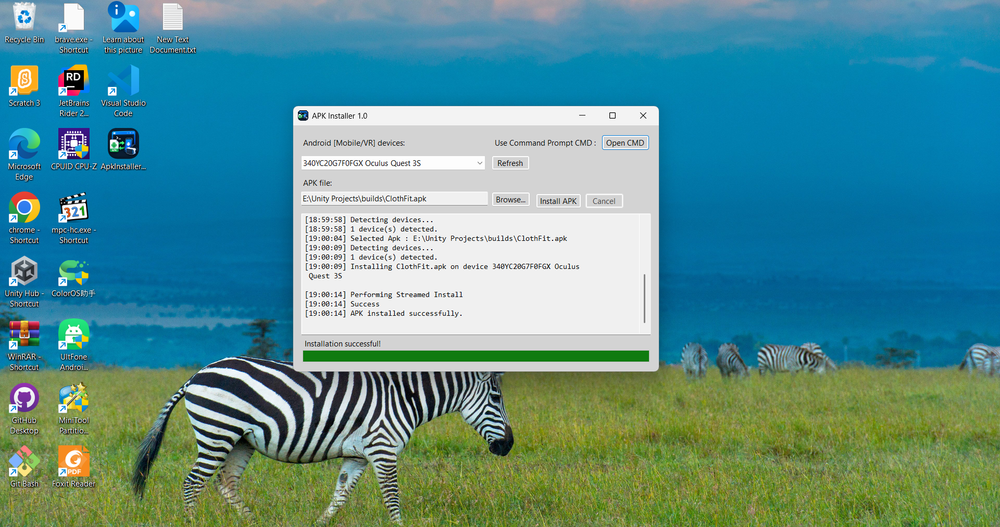
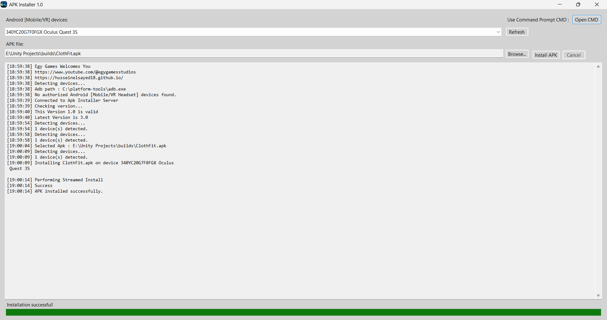
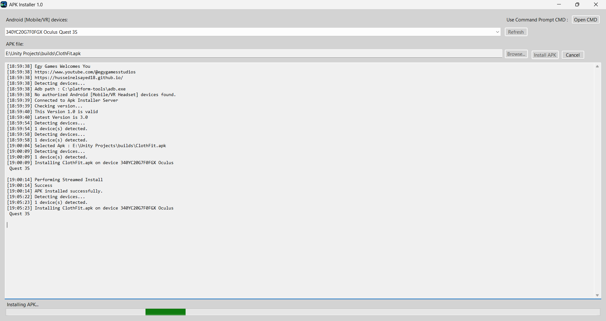
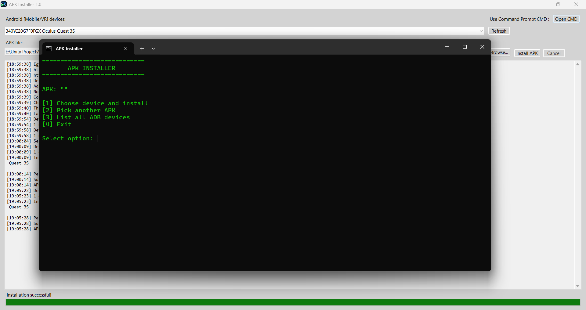
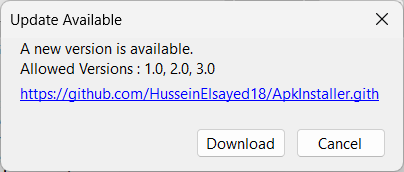
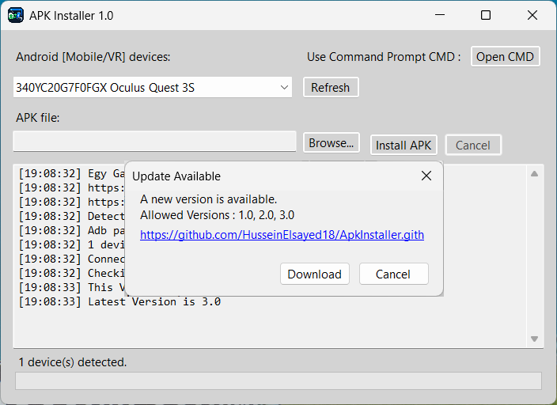
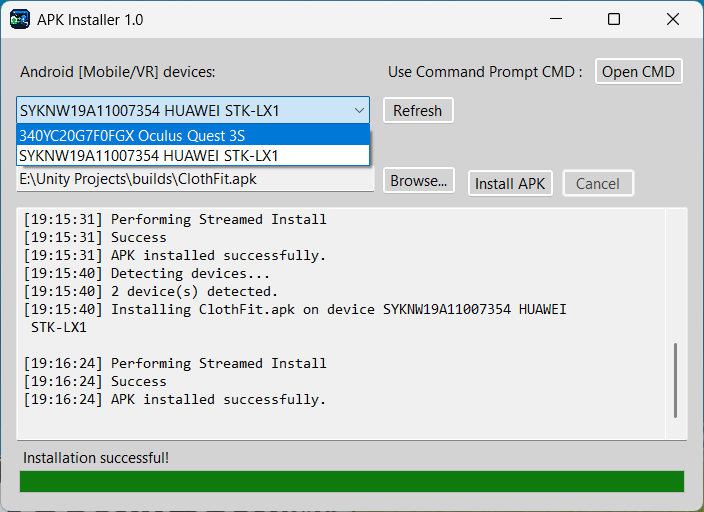
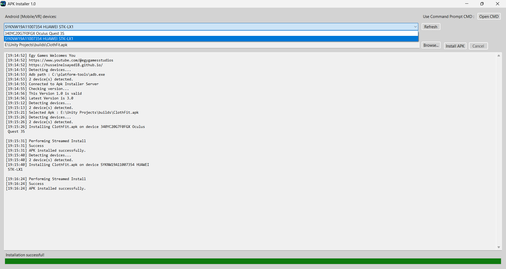

  <a href="https://husseinelsayed18.github.io">🌐 Portfolio</a> &nbsp;&bull;&nbsp;
  <a href="https://www.youtube.com/@egygamesstudios">📺 Egy Games Studios YouTube</a> &nbsp;&bull;&nbsp;
  <a href="mailto:husseinelsayed4g@gmail.com">📧 Email Me</a>

# Android & VR APK Deployment Tool

A Windows desktop utility built with **C# and .NET 9** that simplifies APK installation on Android mobile devices and compatible VR headsets using **Android Debug Bridge (ADB)**.

The tool provides a simple graphical interface for managing APK deployment, monitoring installation progress, viewing operation logs, and checking for application updates.

## Features

- **APK Installation** — Install APK files on Android mobile devices and compatible VR headsets.
- **ADB Integration** — Execute Android Debug Bridge commands directly from the Windows application.
- **Progress Tracking** — Monitor installation progress through a progress bar.
- **Operation Logs** — View detailed logs to follow deployment operations and troubleshoot issues.
- **Automatic Update Checking** — Check for newer versions when the application starts and download available updates.
- **Command-Line Integration** — Execute command-line operations through the desktop interface.
- **Code Obfuscation** — Make reverse engineering and unauthorized code reuse more difficult.
- **Multiple Architectures** — Available executable builds for x64, x86, and ARM64 Windows environments.

## Technologies

| Technology | Purpose |
|---|---|
| C# | Application development |
| .NET 9 | Runtime and development framework |
| Windows Forms | Desktop graphical user interface |
| Android Debug Bridge (ADB) | Android device communication and APK installation |
| Command-Line Integration | Execute ADB commands and deployment operations |
| Code Obfuscation | Help protect application code |

## Supported Executable Architectures

| Build | Target architecture |
|---|---|
| x64 | 64-bit x86 processors |
| x86 | 32-bit x86 processors |
| ARM64 | 64-bit ARM processors |

**Note:** Runtime requirements depend on how each executable was published, including whether the build is self-contained.

## Demo Video

▶️ Watch the **Android & VR APK Deployment Tool** in action.

https://github.com/user-attachments/assets/0c802cfe-9119-4c5a-b27c-102473c8ca9a

[ Watch Android & VR APK Deployment Tool Demo](<Assets/video/Android%20%26%20VR%20APK%20Deployment%20Tool.mp4>)

## Screenshots

Add screenshots of the application interface to showcase its functionality.

### Main Interface

### Installation Progress

### Operation Logs

> Replace these example image paths with your actual screenshots and commit the images to your repository.

## How to Use

1. Launch the application.
2. Allow it to check for available updates.
3. Connect your Android device or compatible VR headset.
4. Ensure USB debugging is enabled and the device authorizes the computer, or configure another supported ADB connection.
5. Select the APK file you want to install.
6. Start the installation and monitor the progress bar and operation logs.
7. Review the logs to confirm the result or diagnose any errors.

## Requirements

- A compatible Windows environment.
- An executable build matching your system architecture.
- An Android device or compatible VR headset.
- ADB available to the application.
- Appropriate device authorization and debugging settings.

Additional requirements may depend on the specific release and deployment configuration.

## Project Goals

This project was built to simplify Android and VR application deployment by bringing common ADB operations into a convenient Windows Forms interface. It combines desktop application development, process execution, progress reporting, logging, update management, and multi-architecture distribution.

## Developer

**Hussein Elsayed**  
Unity Game Developer | C# Developer | XR Developer

- **Portfolio:** https://husseinelsayed18.github.io/
- **GitHub:** https://github.com/HusseinElsayed18
- **LinkedIn:** https://linkedin.com/in/husseinelsayed18
- **YouTube:** https://www.youtube.com/@egygamesstudios

---

  <a href="https://husseinelsayed18.github.io">🌐 Portfolio</a> &nbsp;&bull;&nbsp;
  <a href="https://www.youtube.com/@egygamesstudios">📺 Egy Games Studios YouTube</a> &nbsp;&bull;&nbsp;
  <a href="mailto:husseinelsayed4g@gmail.com">📧 Email Me</a>

*Built with C#, .NET 9, Windows Forms, and Android Debug Bridge (ADB).* 
